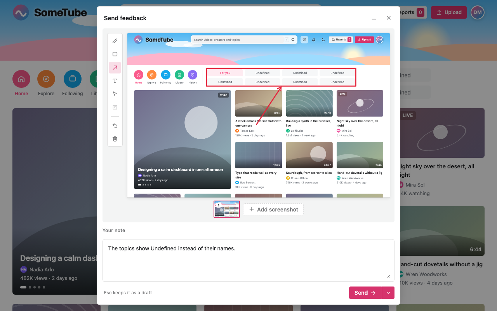

# visual-feedback

A small button lets your users screenshot the page, mark it up and write a note. You receive one
report and store it where you want. It has no service, no tracking and no global CSS, and it fits
any design.

**Try it [here](https://dorumrr.github.io/visual-feedback/)**. A report you send stays in the page, as the site's own list.



```sh
npm install visual-feedback
```

In the browser, through a bundler (without one, see [docs/API.md](docs/API.md)):

```js
import { createFeedback } from "visual-feedback";

createFeedback({ endpoint: "/api/feedback" });
```

On the server, where the report arrives (a Next.js route here). This route checks the report and
stores nothing yet: a recipe in [docs/recipes/](docs/recipes/) stores it, and says how to keep it
private.

```ts
// app/api/feedback/route.ts
import { FeedbackRequestError, parseFeedbackRequest } from "visual-feedback/server";

export async function POST(request: Request): Promise<Response> {
  try {
    const { report } = await parseFeedbackRequest(request);
    // Store `report`, images included: docs/recipes/ has tested code for six places.
    return new Response(null, { status: 204 });
  } catch (error) {
    if (error instanceof FeedbackRequestError) {
      return new Response(error.message, { status: error.status });
    }
    throw error;
  }
}
```

In React or Next.js, render the component once, in the root layout:

```tsx
// app/layout.tsx
import { Feedback } from "visual-feedback/react";

export default function RootLayout({ children }: { children: React.ReactNode }) {
  return (
    <html lang="en">
      <body>
        {children}
        <Feedback endpoint="/api/feedback" />
      </body>
    </html>
  );
}
```

- Where to store reports, with tested code: [docs/recipes/](docs/recipes/)
- With sign-in: call `discardDraft()` at logout, so a kept draft never comes back for the next
  user ([docs/API.md](docs/API.md))
- Behaviour and privacy: [docs/SPEC.md](docs/SPEC.md)
- Options, methods and types: [docs/API.md](docs/API.md)
- Making it match your site: [docs/THEMING.md](docs/THEMING.md)
- For coding agents: [AGENTS.md](AGENTS.md)
- Source, issues and releases: [github.com/dorumrr/visual-feedback](https://github.com/dorumrr/visual-feedback)

MIT
